# Gradient Backdrops

Animated gradient backgrounds that look designed, not default. One dependency-free WebGL file, 15 shader styles, 29 ready-made presets, and a set of CSS-only recipes for when you don't want motion.

It works two ways:

- **As a plain web library.** Copy `assets/backdrop.js` into any site and add a `data-backdrop` attribute.
- **As a [Claude Code](https://claude.com/claude-code) skill.** Drop the folder into your skills directory and ask for "a nicer animated hero background". Claude picks a style, chooses colours to match your brand, and wires it in.

<p align="center">
  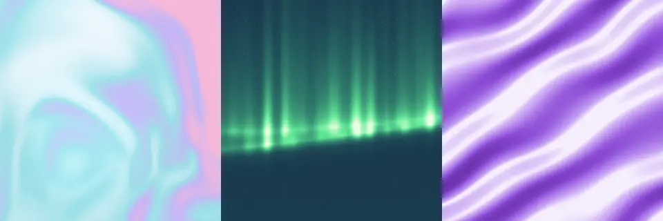
</p>

## Quick start

Add the script, then put an attribute on any element. The backdrop is inserted behind the element's existing content, so no extra CSS is needed.

```html
<section class="hero" data-backdrop="fluid" data-grain="0.14">
  <h1>Always in motion.</h1>
</section>

<script src="/lib/backdrop/backdrop.js"></script>
```

With your own colours and settings:

```html
<section data-backdrop="aurora"
         data-colors="#EDFFEB #5FE896 #2E7A6A #132B45"
         data-params='{"fold":1.4}'
         data-speed="0.8">
  …
</section>
```

From JavaScript (works with any bundler, via the ES module wrapper):

```js
import { createBackdrop } from './lib/backdrop/backdrop.mjs';

const bd = createBackdrop(document.querySelector('.hero'), {
  style: 'flow',                       // or a preset name: 'iridescent-cloud'
  colors: ['#F6F9FF', '#9BE0E8', '#C4B5F7', '#F8B8D9'],
  params: { scale: 0.9, warp: 1 },     // per-style knobs
  speed: 1,
  grain: 0.12,
});

bd.set({ colors: ['#EAF4FC', '#1E50A2', '#895B8A', '#F09199'] });
bd.pause(); bd.play();
const png = bd.snapshot();             // data URL of the current frame
bd.destroy();
```

Need a static look with zero JavaScript at runtime? `cssBackdrop()` returns a CSS `background` value:

```js
import { cssBackdrop } from './lib/backdrop/backdrop.mjs';
el.style.background = cssBackdrop('mesh', ['#EAF4FC', '#B28FCE', '#F4B3C2', '#A0D8EF']);
```

React, Vue, Svelte, Astro and Tailwind snippets are in [`references/frameworks.md`](references/frameworks.md).

## Try it

The fastest way to explore is the live gallery. Every card is a running backdrop; click one to open a playground with colour pickers and sliders, then copy the finished config as JS or HTML.

```bash
git clone https://github.com/nonlineartom/gradient-backdrops.git
cd gradient-backdrops
python3 -m http.server 8000
# open http://localhost:8000/examples/gallery.html
```

<p align="center">
  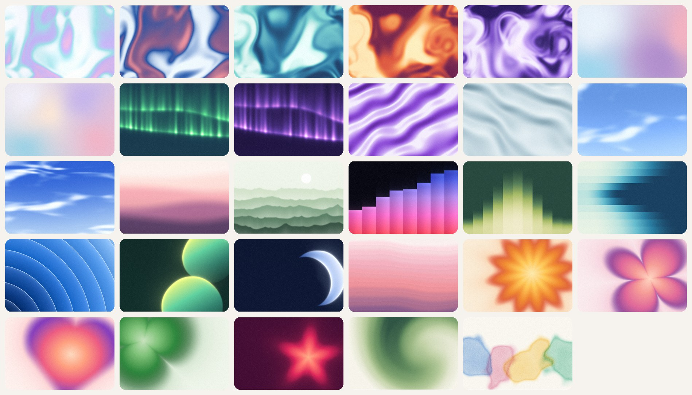
</p>

## Styles

Fifteen shader styles. Each has its own parameters, documented in [`references/styles.md`](references/styles.md). **Colour order matters**: the same palette looks quite different in `aurora` and `silk`, so follow the order in the table.

| | Style | Looks like | Colour order |
|---|---|---|---|
| 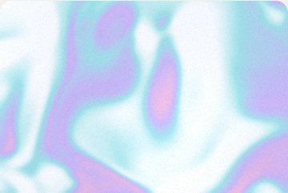 | `flow` | Liquid, iridescent fluid with slow domain-warped swirls | any; the field sweeps the ramp |
|  | `mesh` | Soft blurred colour points, Figma or Apple mesh | one colour per point |
| 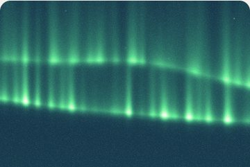 | `aurora` | Northern-lights curtains over a night sky | highlight → night background |
| 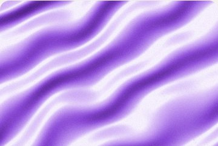 | `silk` | Lit satin folds with sheen | dark → light |
|  | `sky` | Blue sky with wispy clouds | cloud white → deep sky |
|  | `waves` | Soft layered horizontal bands, a sunset sea | top → bottom |
| 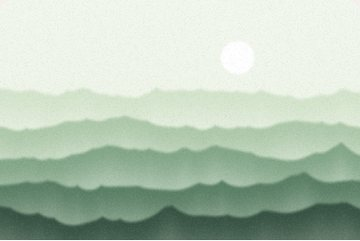 | `mist` | Misty mountain ridges with a sun | sky → nearest ridge |
| 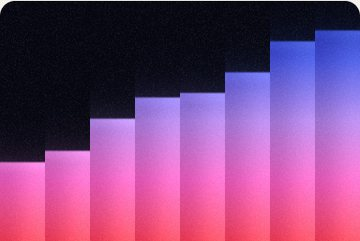 | `bars` | Rising gradient bars, like an equaliser | background, then bar top → bottom |
| 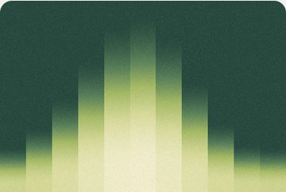 | `prism` | Stepped glowing columns | dark background → light glow |
|  | `rings` | Concentric glowing rings rippling out | inner → outer |
| 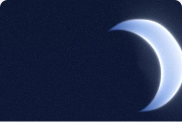 | `glow` | Rim-lit orbs or a crescent moon on dark | background, body dark → lit, rim |
| 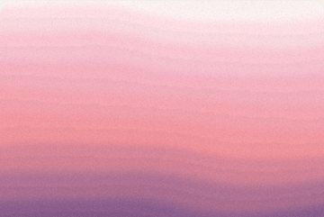 | `stripes` | Softly stepped horizontal bands | top → bottom |
| 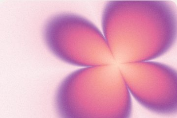 | `forms` | One big blurred shape: burst, flower, heart, clover, blob, star | background, centre → edge |
| 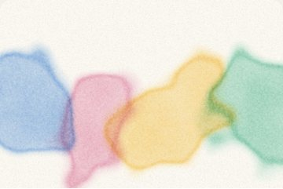 | `watercolor` | Pigment washes on paper with dark edges | paper, then pigments |
| 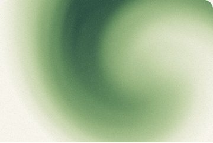 | `swirl` | A slow twisting gradient vortex | light → dark |

### Presets

Presets are named, ready-to-use combinations of style, colours and parameters. Pass one as `preset: 'name'` or `data-backdrop="name"`, and swap in your own colours while keeping the order convention.

`fluid` `iridescent-cloud` `lagoon` `solar-flare` `orchid` (flow) · `soft-signal` `any-words` (mesh) · `night-swim` `violet-veil` (aurora) · `amethyst` `pearl-silk` (silk) · `blue-sky` `start-here` (sky) · `tidal` (waves) · `field-notes` (mist) · `after-hours` (bars) · `citron` `glacier` (prism) · `ambient` (rings) · `edge` `moons` (glow) · `gather` (stripes) · `solstice` `petal` `with-love` `celtics` `bloom` (forms) · `verdant` (swirl) · `paper-garden` (watercolor)

CSS-only presets: `slow-days` `rosa` `atelier` `soft-signal` `halo`

## Examples

Each example is a single HTML file you can open straight from the repo.

| | |
|---|---|
| 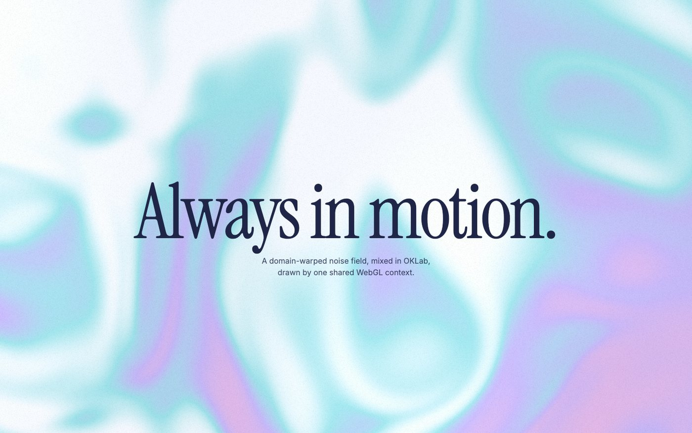 | **[`examples/hero.html`](examples/hero.html)**<br>The minimal pattern: a full-bleed hero with a preset, plus a second section with a custom palette. About 40 lines. |
| 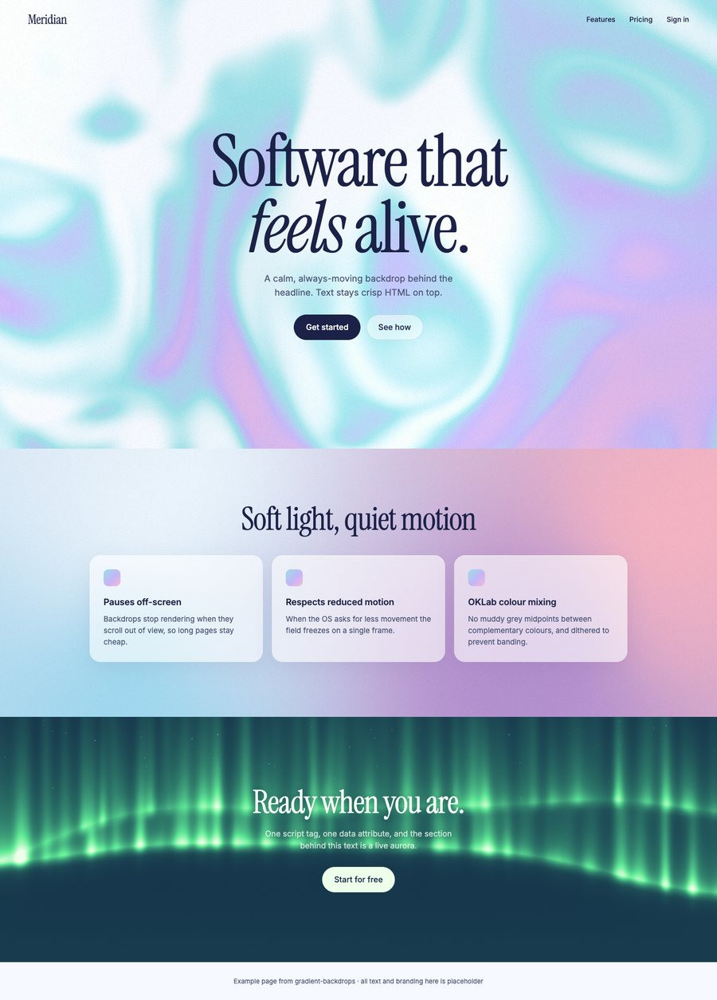 | **[`examples/landing.html`](examples/landing.html)**<br>A whole landing page built from three backdrops: a calm flowing hero, a mesh behind frosted cards, and a dark aurora call to action. |
| 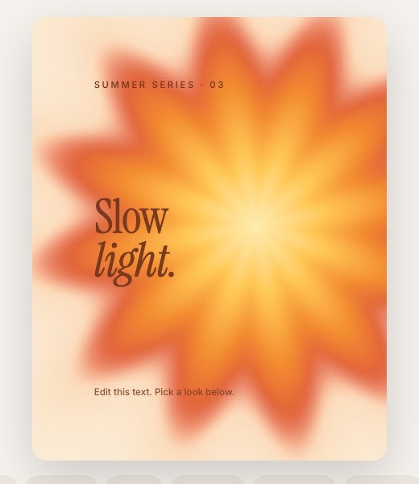 | **[`examples/poster.html`](examples/poster.html)**<br>A 4:5 social card with editable text. Pick a look, then save the backdrop as a PNG with `bd.snapshot()`. |
| 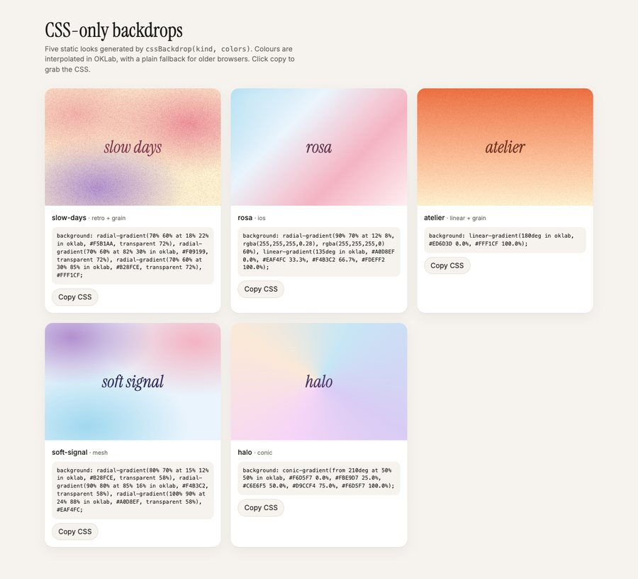 | **[`examples/css-only.html`](examples/css-only.html)**<br>The five static CSS recipes with copy-paste output. No canvas, no JavaScript needed at runtime. |
| | **[`examples/gallery.html`](examples/gallery.html)**<br>Every preset live, with a full-screen playground and *Copy JS / Copy HTML* buttons. |
| | **[`examples/bench.html`](examples/bench.html)**<br>A live fps and render-size HUD, for checking performance in a specific browser. |

## Options

| Option | Default | |
|---|---|---|
| `preset` | | A preset name, used as the base for `style`, `colors` and `params`. |
| `style` | | One of the 15 style names. |
| `colors` | | 2–6 CSS colours (hex, `rgb()`, `hsl()`, `oklch()`, names). Order matters per style. |
| `params` | | Style-specific knobs. See [`references/styles.md`](references/styles.md). |
| `speed` | `1` | Animation speed multiplier. `0` freezes the motion. |
| `grain` | `0` | Film-grain overlay opacity, 0 to 1. Around 0.1–0.25 is typical. |
| `seed` | `0` | Varies the composition without changing the look. |
| `animate` | `true` | `false` renders a single still frame. |
| `respectReducedMotion` | `true` | Freeze when the OS asks for reduced motion. |
| `quality` | per style | Render scale relative to CSS pixels × DPR. Soft styles default to 0.35–0.5. |
| `maxPixels` | `2.4M` | Hard cap on rendered pixels. |
| `mode` | `'auto'` | `'direct'`, `'shared'` or `'auto'`. See below. |

TypeScript definitions are in [`assets/backdrop.d.ts`](assets/backdrop.d.ts).

## How it behaves

- **OKLab mixing.** Colours blend in OKLab, so complementary colours don't pass through a muddy grey midpoint.
- **Dithered output.** Every frame is dithered, so there's no gradient banding.
- **Cheap by default.** Backdrops pause when scrolled off-screen, and soft styles render at reduced resolution (0.35–0.5×), which looks identical and costs far less.
- **Respects reduced motion.** With `prefers-reduced-motion: reduce`, the field freezes on one frame.
- **Own canvas, fast path.** Each backdrop draws straight into its own WebGL canvas, which is the fast path in every browser including Safari. Past 12 backdrops on one page, the extras share one hidden context and are copied in, so galleries still work.
- **Graceful fallback.** Without WebGL, the element gets a static CSS mesh in the same colours. Give the element its own CSS `background` as well so the first paint isn't blank.

A few practical notes: keep `speed` at 1 or below behind reading content, check text contrast over the busiest part of the backdrop (a scrim or lower `contrast` helps), create backdrops on the client only when server-rendering, and avoid `mix-blend-mode`, `filter` or `backdrop-filter` layers over a large animating canvas. [`references/recipes.md`](references/recipes.md) has the legibility, performance and accessibility checklists.

## Use it as a Claude Code skill

This repo is already laid out as a skill: `SKILL.md` is at the root. Clone it into your personal skills folder:

```bash
git clone https://github.com/nonlineartom/gradient-backdrops.git ~/.claude/skills/gradient-backdrops
```

Or into a single project, so it's shared with your team:

```bash
git clone https://github.com/nonlineartom/gradient-backdrops.git .claude/skills/gradient-backdrops
```

Then just describe what you want:

> Make the hero background a slow liquid gradient in our brand colours.

> Add an aurora backdrop behind the signup section.

> I want something like a Stripe-style moving background, but warmer.

Claude will choose a style, copy `assets/backdrop.js` into your project (it never hot-links the skill folder), mount it, and check that the text stays legible. It can also open the gallery for you to choose a look and paste back the config.

### What's in the repo

```
SKILL.md              the skill: when to use it, workflow, style table, gotchas
assets/
  backdrop.js         the runtime (classic script, exposes window.GradientBackdrop)
  backdrop.mjs        ES module wrapper
  backdrop.d.ts       TypeScript types
references/
  styles.md           every style's parameters, palette guidance and tuning tips
  recipes.md          CSS-only gradients, grain, legibility, performance
  frameworks.md       React, Vue, Svelte, Astro, Tailwind
  techniques.md       how the renderer works, and how to write a new style
examples/             hero, landing, poster, css-only, gallery, bench
docs/img/             images used in this README
```

## Writing your own style

Each style is a GLSL fragment `main()` appended to a shared prelude that provides noise, OKLab ramp helpers, rotation, hashing and dithering. Register it in `STYLES` with its parameters and each one becomes a uniform. [`references/techniques.md`](references/techniques.md) documents the prelude API and the techniques behind the existing styles: domain warping, SDF shapes, Beer–Lambert pigment absorption, and exporting to video or PNG.

## Browser support

Any evergreen browser with WebGL 1 (Chrome, Edge, Firefox, Safari, and their mobile versions). The CSS-only recipes use `in oklab` interpolation, with a plain fallback declaration for older engines.

## Credits

- Simplex noise: Ashima Arts and Stefan Gustavson (MIT), from `webgl-noise`.
- Hash without sine: Dave Hoskins (MIT).
- Domain warping and the heart SDF: [Inigo Quilez](https://iquilezles.org/articles/)'s articles.
- OKLab: Björn Ottosson.
- The look and feel, and the colourways of the presets, were inspired by [feralui.dev](https://feralui.dev)'s gradient gallery. The implementation here is original; their code and their compositions are their own.

## License

[MIT](LICENSE)
